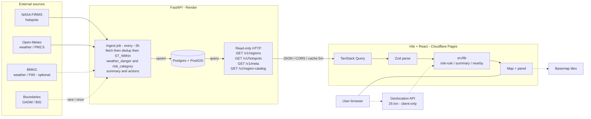

# API Contract — pantau-mala (MVP)

|                 |                                                     |
| --------------- | --------------------------------------------------- |
| **Version**     | 2.3-live — 11 Oktober 2026                          |
| **Status**      | Binding wire — BE (FastAPI) ↔ FE (Vite)             |
| **Wire keys**   | **English `snake_case`**                            |
| **Enum values** | Domain literals (mostly Indonesian) — see §3        |
| **Stack BE**    | FastAPI (Python) — ingest job + read-only HTTP      |
| **Stack FE**    | Vite · React · TanStack Query · Zod                 |
| **Sources**     | OpenAPI `{base}/docs` · **[Handoff FE](prd-fe.md)** |

> **Prioritas:** Keputusan produk di [`prd-fe.md`](prd-fe.md) menang jika bentrok dengan draft lama (Kemendagri `62.*`, cadence jam-an, sparkline MVP). Dokumen ini = detail wire yang selaras handoff v2.3.

**Bahasa dokumen**

| Layer                                         | Language             |
| --------------------------------------------- | -------------------- |
| Paths, JSON keys, operation IDs, schema names | **English**          |
| Penjelasan produk / UI                        | **Bahasa Indonesia** |

**Breaking change v2:** Wire JSON tidak lagi memakai key Indonesia (`kode`, `titik_panas_24j`, …). Dummy lama di `public/data/*` dihapus / tidak dipakai FE live.

---

## 1. Delivery model

### 1.1 Overview

FastAPI menyajikan **JSON read-only**. Tidak ada auth, mutation, atau WebSocket di MVP. Browser tidak memanggil FIRMS / Open-Meteo (kecuali basemap + Geolocation).



### 1.2 Base URL (FE)

| `VITE_DATA_URL`           | Perilaku                                 |
| ------------------------- | ---------------------------------------- |
| empty                     | Error — FE live **wajib** set base URL   |
| `https://api.example.com` | `{base}/v1/...` (base tanpa slash akhir) |

### 1.3 Headers & cache

| Item           | Contract                                                                      |
| -------------- | ----------------------------------------------------------------------------- |
| `Content-Type` | `application/json` (hotspots: `application/geo+json` atau `application/json`) |
| CORS           | `GET` untuk origin web                                                        |
| Cache          | Dinamis ≤ **5 minutes**; catalog boleh lebih lama (`max-age=86400`)           |
| Auth           | None                                                                          |

### 1.4 Update cadence

| Resource                | Cadence                                  |
| ----------------------- | ---------------------------------------- |
| Regions, Hotspots, Meta | **~3 jam** (badge stale ≈ 3.5 jam di FE) |
| Region catalog          | Rare / static                            |

FE refresh (referensi): `staleTime` 5 min; `refetchInterval` 3 jam; catalog stale 24 h.

---

## 2. Endpoints

| Operation ID       | Method | Path                 | Response                   | FE hook            |
| ------------------ | ------ | -------------------- | -------------------------- | ------------------ |
| `listRegions`      | `GET`  | `/v1/regions`        | `Region[]`                 | `useRegions`       |
| `listHotspots`     | `GET`  | `/v1/hotspots`       | `HotspotFeatureCollection` | `useHotspots`      |
| `getMeta`          | `GET`  | `/v1/meta`           | `Meta`                     | `useMeta`          |
| `getRegionCatalog` | `GET`  | `/v1/region-catalog` | `RegionCatalog`            | `useRegionCatalog` |
| `health`           | `GET`  | `/health`            | `{ "status": "ok" }`       | —                  |

Path lama Indonesia (`/wilayah.json`, …) **bukan** kontrak v2. Alias file-style opsional, tidak wajib.

---

## 3. Shared enums

Literal **case-sensitive**.

| Enum                  | Allowed values                               | Penjelasan                      |
| --------------------- | -------------------------------------------- | ------------------------------- |
| `TimeZoneId`          | `WIB` \| `WITA` \| `WIT`                     | Zona tampilan waktu             |
| `RiskCategory`        | `rendah` \| `sedang` \| `sangat_tinggi`      | Kategori pin/chip               |
| `WeatherDangerClass`  | `aman` \| `waspada` \| `bahaya` \| `ekstrem` | Kelas FDRS/FWI                  |
| `WeatherDangerSource` | `BMKG` \| `FWI dihitung`                     | Asal FWI (live: `FWI dihitung`) |
| `AirQualityCategory`  | `baik` \| `sedang` \| `tidak_sehat`          | Dari PM2.5                      |
| `ConfidenceLevel`     | `rendah` \| `sedang` \| `tinggi`             | Keyakinan FIRMS                 |
| `SourceStatus`        | `ok` \| `terlambat` \| `gagal`               | Status pipeline                 |

Coordinates: always **`[longitude, latitude]`**.

---

## 4. `GET /v1/regions` → `Region[]`

**Penjelasan:** Satu objek per kab/kota dengan titik panas aktif (MVP). Sumber pin/agregat, filter, detail, kartu ringkasan.

**MVP filter (BE):** Response hanya `risk_category` ∈ {`sedang`, `sangat_tinggi`}. Wilayah `rendah` tidak dikirim.

**Kode wilayah:** **GADM** (`IDN.*`). Kemendagri (`62.11`) **belum** di wire MVP.

### 4.1 Schema

| JSON key                    | Type                  | Req | Penjelasan                                                        |
| --------------------------- | --------------------- | --- | ----------------------------------------------------------------- |
| `code`                      | string                | yes | GADM kab/kota (`IDN.12.3_1`)                                      |
| `name`                      | string                | yes | Nama tampilan (sudah dinormalisasi BE)                            |
| `province`                  | string                | yes | Nama provinsi (sudah dinormalisasi BE)                            |
| `time_zone`                 | `TimeZoneId`          | yes | Zona waktu lokal                                                  |
| `center`                    | `[lon, lat]`          | yes | Centroid pin & cuaca                                              |
| `risk_category`             | `RiskCategory`        | yes | Hasil rule §8.1 (hitung di BE)                                    |
| `weather_danger`            | object                | yes | Info cuaca — **bukan** penentu warna pin                          |
| `weather_danger.class`      | `WeatherDangerClass`  | yes |                                                                   |
| `weather_danger.fwi`        | number                | yes |                                                                   |
| `weather_danger.source`     | `WeatherDangerSource` | yes |                                                                   |
| `hotspots_24h`              | number                | yes | Count 24 jam (confidence `sedang`+`tinggi`, after dedup)          |
| `trend_7d`                  | number[7]             | yes | Index `0` = 6 days ago … `6` = today (UTC). **FE abaikan UI MVP** |
| `weather`                   | object                | yes |                                                                   |
| `weather.temp_c`            | number                | yes |                                                                   |
| `weather.condition`         | string                | yes | Teks singkat ID                                                   |
| `weather.humidity`          | number                | yes | %                                                                 |
| `weather.wind_kmh`          | number                | yes |                                                                   |
| `weather.dry_days`          | number                | yes |                                                                   |
| `air_quality`               | object                | yes |                                                                   |
| `air_quality.pm25`          | number                | yes | µg/m³                                                             |
| `air_quality.category`      | `AirQualityCategory`  | yes |                                                                   |
| `last_detection`            | object                | yes | Deteksi satelit terbaru                                           |
| `last_detection.time`       | string ISO 8601       | yes | Sering UTC `+00:00` → FE convert pakai `time_zone`                |
| `last_detection.satellite`  | string                | yes | e.g. `VIIRS NOAA-20`                                              |
| `last_detection.confidence` | `ConfidenceLevel`     | yes |                                                                   |
| `last_detection.frp_mw`     | number                | yes |                                                                   |
| `last_detection.village`    | string                | no  | `exclude_none` — sering absen                                     |
| `last_detection.district`   | string                | no  | `exclude_none` — sering absen                                     |
| `summary`                   | string                | yes | Template dari angka                                               |
| `actions`                   | string[]              | yes | Min. 1 saran                                                      |

### 4.2 Invariants

1. `trend_7d` tepat **7** number.
2. Ideal: `trend_7d[6] === hotspots_24h`.
3. `risk_category` = rule §8.1.
4. `code` unik; cocok dengan `region_code` di hotspots (bila ada).

### 4.3 Example

```json
[
  {
    "code": "IDN.12.3_1",
    "name": "Kayong Utara",
    "province": "Kalimantan Barat",
    "time_zone": "WITA",
    "center": [109.92467473342022, -1.0924542546749865],
    "risk_category": "sangat_tinggi",
    "weather_danger": {
      "class": "bahaya",
      "fwi": 21.5,
      "source": "FWI dihitung"
    },
    "hotspots_24h": 12,
    "trend_7d": [0, 0, 11, 3, 15, 20, 12],
    "weather": {
      "temp_c": 31.9,
      "condition": "Mendung",
      "humidity": 58.0,
      "wind_kmh": 10.1,
      "dry_days": 0
    },
    "air_quality": {
      "pm25": 104.8,
      "category": "tidak_sehat"
    },
    "last_detection": {
      "time": "2026-10-10T08:22:00+00:00",
      "satellite": "MODIS",
      "confidence": "sedang",
      "frp_mw": 8.82
    },
    "summary": "12 titik panas dalam 24 jam (satelit NASA FIRMS).",
    "actions": [
      "Jangan membakar lahan, sampah, atau membuang puntung rokok sembarangan.",
      "Bila melihat api, segera hubungi Damkar 113 atau layanan darurat 112."
    ]
  }
]
```

### 4.4 Computed on FE (MVP)

| UI                                    | Rumus                                                     |
| ------------------------------------- | --------------------------------------------------------- |
| Kartu titik panas 24 jam              | Σ `hotspots_24h` (filter aktif)                           |
| Agregat pin provinsi                  | Σ `hotspots_24h` per `province` + catalog `center`/`bbox` |
| Daftar risiko                         | Sort `risk_category` lalu `hotspots_24h` desc             |
| Flag pin                              | `name` + `province` (waktu deteksi di panel detail)       |
| % vs kemarin / sparkline / panah tren | **Post-MVP** — jangan tampilkan di MVP                    |

---

## 5. `GET /v1/hotspots` → GeoJSON FeatureCollection

**Penjelasan:** Titik panas **24 jam**, sudah dedup. Dipakai FE untuk nearby **25 km** + layer titik setelah zoom provinsi. Bukan sumber hitung ulang kartu nasional.

### 5.1 Feature properties

| JSON key                 | Type              | Req                                                               |
| ------------------------ | ----------------- | ----------------------------------------------------------------- |
| `geometry.coordinates`   | `[lon, lat]`      | yes                                                               |
| `properties.time`        | string ISO        | yes                                                               |
| `properties.satellite`   | string            | yes                                                               |
| `properties.confidence`  | `ConfidenceLevel` | yes                                                               |
| `properties.frp_mw`      | number            | yes                                                               |
| `properties.region_code` | string            | **no** — ~6% absen (lepas pantai); BE `ST_Within` + nearest ~5 km |

### 5.2 Example

```json
{
  "type": "FeatureCollection",
  "features": [
    {
      "type": "Feature",
      "geometry": {
        "type": "Point",
        "coordinates": [140.60002, -8.26879]
      },
      "properties": {
        "time": "2026-10-11T03:32:00+00:00",
        "satellite": "VIIRS S-NPP",
        "confidence": "tinggi",
        "frp_mw": 30.31,
        "region_code": "IDN.23.16_1"
      }
    }
  ]
}
```

### 5.3 Counting rules (BE)

- GeoJSON **boleh** berisi `confidence: "rendah"`.
- `hotspots_24h` / `trend_7d` **hanya** `sedang` + `tinggi`.
- Dedup: dekat (jarak + waktu) antar satelit = satu kejadian.
- `features: []` valid.
- Titik tanpa `region_code`: tetap OK untuk nearby koordinat; **tidak** bisa di-join ke pin/detail kab.

---

## 6. `GET /v1/meta` → `Meta`

**Penjelasan:** Stamp pembaruan + kesehatan sumber (badge pojok peta).

| JSON key         | Type            |
| ---------------- | --------------- |
| `updated_at`     | string ISO 8601 |
| `status.firms`   | `SourceStatus`  |
| `status.weather` | `SourceStatus`  |
| `status.air`     | `SourceStatus`  |

```json
{
  "updated_at": "2026-10-11T05:57:32.890226+00:00",
  "status": {
    "firms": "ok",
    "weather": "ok",
    "air": "ok"
  }
}
```

FE: relatif waktu; stale bila usia > **~3.5 jam**.

---

## 7. `GET /v1/region-catalog` → `RegionCatalog`

**Penjelasan:** Katalog pencarian lengkap (termasuk kab tanpa hotspot). Join ke regions via `code`. Pin overview **agregat** pakai `provinces[].center` + `bbox`; pin kab **bukan** dari catalog.

| JSON key                | Type                               | Penjelasan          |
| ----------------------- | ---------------------------------- | ------------------- |
| `note`                  | string                             | optional            |
| `provinces`             | array                              |                     |
| `provinces[].code`      | string                             | GADM L1             |
| `provinces[].name`      | string                             | = `Region.province` |
| `provinces[].bbox`      | `[minLon, minLat, maxLon, maxLat]` | zoom drill-in       |
| `provinces[].center`    | `[lon, lat]`                       | pin agregat         |
| `regencies`             | array                              | kab/kota            |
| `regencies[].code`      | string                             | GADM L2             |
| `regencies[].name`      | string                             |                     |
| `regencies[].province`  | string                             | nama provinsi       |
| `regencies[].center`    | `[lon, lat]`                       |                     |
| `regencies[].time_zone` | `TimeZoneId`                       |                     |

Contoh nama: `DKI Jakarta`, `Kalimantan Tengah`, `Kep. Bangka Belitung`, `DI Yogyakarta`.

```json
{
  "note": "optional",
  "provinces": [
    {
      "code": "IDN.23",
      "name": "Papua",
      "bbox": [134.5, -9.5, 141.0, -0.5],
      "center": [138.0, -4.5]
    }
  ],
  "regencies": [
    {
      "code": "IDN.23.16_1",
      "name": "Komposisi contoh",
      "province": "Papua",
      "center": [140.6, -8.2],
      "time_zone": "WIT"
    }
  ]
}
```

---

## 8. Business rules

### 8.1 Risk category (BE) — murni NASA FIRMS

Hanya `hotspots_24h` (confidence `sedang`+`tinggi`). **FWI / cuaca tidak masuk rumus.**

```
rendah         ⇔  hotspots_24h = 0
sedang         ⇔  hotspots_24h 1 … 9
sangat_tinggi  ⇔  hotspots_24h ≥ 10
```

FE menampilkan `risk_category` dari API; BE wajib konsisten. `weather_danger` tetap di wire untuk info cuaca, bukan penentu pin.

### 8.2 Trend / sparkline (FE) — **post-MVP**

Jangan tampilkan panah naik-turun atau sparkline di MVP. Field `trend_7d` tetap di JSON.

### 8.3 Daily change % (FE) — **post-MVP**

Kartu nasional MVP = Σ `hotspots_24h` saja.

### 8.4 Copy fields (BE)

- `summary`: template dari angka.
- `actions`: per `risk_category` + tambahan bila udara buruk; untuk `sangat_tinggi` sebut Damkar **113** / **112**.

### 8.5 Open decisions

- Ambang FWI → `WeatherDangerClass`
- Ambang PM2.5 → `AirQualityCategory`
- Parameter dedup FIRMS
- Migrasi kode ke Kemendagri (fase berikutnya)

---

## 9. Responsibility matrix

| Concern                                        | BE  | FE                        |
| ---------------------------------------------- | --- | ------------------------- |
| Ingest FIRMS, weather, air                     | ✓   | —                         |
| Hotspot dedup + `region_code` join             | ✓   | —                         |
| Normalisasi nama + `time_zone`                 | ✓   | tampilkan                 |
| `hotspots_24h`, `trend_7d`                     | ✓   | agregat display (Σ count) |
| `weather_danger`, `risk_category`              | ✓   | display                   |
| `weather`, `air_quality`, `summary`, `actions` | ✓   | display                   |
| `last_detection`                               | ✓   | flag / detail             |
| Meta                                           | ✓   | badge                     |
| Region catalog                                 | ✓   | search + pin agregat bbox |
| Filters, nearby 25 km, pin agregat provinsi    | —   | ✓                         |
| Sparkline / % vs kemarin / panah tren          | —   | post-MVP                  |

---

## 10. Errors

| Situation                      | BE                                         | FE                   |
| ------------------------------ | ------------------------------------------ | -------------------- |
| Non-2xx                        | Jangan timpa data bagus tanpa status gagal | EmptyState load fail |
| Invalid / missing field        | Jangan publish                             | Zod fail             |
| Wrong enum                     | 422 / jangan publish                       | Parse fail           |
| `features: []` / `regions: []` | Valid                                      | Empty UI OK          |

**Breaking change** = rename key, hapus field wajib, ubah enum, ubah skema `code` (GADM ↔ Kemendagri), atau ubah urutan `trend_7d`.

---

## 11. Migration from v1 (Indonesian keys)

| v1 key                       | v2 key                      |
| ---------------------------- | --------------------------- |
| `kode`                       | `code`                      |
| `nama`                       | `name`                      |
| `provinsi`                   | `province`                  |
| `zona_waktu`                 | `time_zone`                 |
| `pusat`                      | `center`                    |
| `kategori`                   | `risk_category`             |
| `bahaya_cuaca`               | `weather_danger`            |
| `bahaya_cuaca.kelas`         | `weather_danger.class`      |
| `bahaya_cuaca.sumber`        | `weather_danger.source`     |
| `titik_panas_24j`            | `hotspots_24h`              |
| `tren_7h`                    | `trend_7d`                  |
| `cuaca`                      | `weather`                   |
| `cuaca.suhu_c`               | `weather.temp_c`            |
| `cuaca.kondisi`              | `weather.condition`         |
| `cuaca.kelembapan`           | `weather.humidity`          |
| `cuaca.angin_kmj`            | `weather.wind_kmh`          |
| `cuaca.hari_tanpa_hujan`     | `weather.dry_days`          |
| `udara`                      | `air_quality`               |
| `udara.kategori`             | `air_quality.category`      |
| `deteksi_terakhir`           | `last_detection`            |
| `deteksi_terakhir.waktu`     | `last_detection.time`       |
| `deteksi_terakhir.satelit`   | `last_detection.satellite`  |
| `deteksi_terakhir.keyakinan` | `last_detection.confidence` |
| `deteksi_terakhir.desa`      | `last_detection.village`    |
| `deteksi_terakhir.kecamatan` | `last_detection.district`   |
| `ringkasan`                  | `summary`                   |
| `saran`                      | `actions`                   |
| `properties.waktu`           | `properties.time`           |
| `properties.satelit`         | `properties.satellite`      |
| `properties.keyakinan`       | `properties.confidence`     |
| `properties.kode_wilayah`    | `properties.region_code`    |
| `diperbarui`                 | `updated_at`                |
| `status.cuaca`               | `status.weather`            |
| `status.udara`               | `status.air`                |
| `_catatan`                   | `note`                      |
| `provinsi[]` (catalog)       | `provinces`                 |
| `kabkota[]`                  | `regencies`                 |

FE checklist: `types.ts`, `schema.ts`, `queries.ts` → `/v1/*`, join `IDN.*`, tanpa dummy v1.

---

## 12. Release checklist

- [ ] `/v1/regions|hotspots|meta|region-catalog` + OpenAPI `/docs`
- [ ] Body lolos Zod FE
- [ ] `code` / `region_code` = **GADM** `IDN.*`
- [ ] `risk_category` = §8.1
- [ ] `trend_7d[6] === hotspots_24h` (ideal)
- [ ] `region_code` opsional; join saat ada
- [ ] Nama provinsi catalog = `Region.province`
- [ ] CORS + cache §1.3
- [ ] Cadence ~3 jam; FE stale ~3.5 jam
- [ ] `VITE_DATA_URL` → FastAPI base (tanpa trailing slash)

---

## 13. References

| Artifact                 | Path                              |
| ------------------------ | --------------------------------- |
| Handoff FE (binding)     | `docs/prd-fe.md`                  |
| UI copy / ikon / tooltip | `docs/fe-ui-copy.md`              |
| Pin flag UI              | `docs/spek-flag-deteksi.md`       |
| FE types / Zod / queries | `src/data/*`                      |
| Risk rule                | `src/lib/risk-rule.ts`            |
| Summary / nearby         | `src/lib/summary.ts`, `nearby.ts` |
| OpenAPI                  | `{VITE_DATA_URL}/docs`            |

---

_v2.3-live: English `snake_case`, GADM codes, risk FIRMS-only, cadence ~3h, no sparkline/tren UI di MVP._
