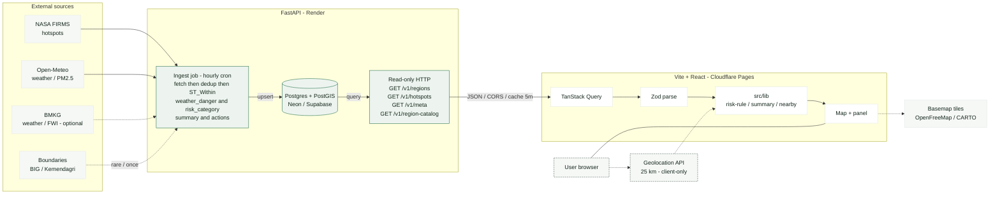

# API Contract — forever-young (MVP)

|                 |                                                |
| --------------- | ---------------------------------------------- |
| **Version**     | 2.0 — 11 Oktober 2026                          |
| **Status**      | Binding — BE (FastAPI) ↔ FE (Vite)             |
| **Wire keys**   | **English `snake_case`**                       |
| **Enum values** | Domain literals (mostly Indonesian) — see §3   |
| **Stack BE**    | FastAPI (Python) — ingest job + read-only HTTP |
| **Stack FE**    | Vite · React · TanStack Query · Zod            |
| **Sources**     | [PRD](prd.md) · [PRD ringkas](prd-ringkas.md)  |

**Bahasa dokumen**

| Layer                                         | Language             |
| --------------------------------------------- | -------------------- |
| Paths, JSON keys, operation IDs, schema names | **English**          |
| Penjelasan produk / UI                        | **Bahasa Indonesia** |

**Breaking change v2:** Wire JSON tidak lagi memakai key Indonesia (`kode`, `titik_panas_24j`, …). BE dan FE harus memakai schema ini. Dummy lama di `public/data/*` perlu dimigrasi (atau di-serve lewat adapter sementara).

---

## 1. Delivery model

### 1.1 Overview

FastAPI menyajikan **JSON read-only**. Tidak ada auth, mutation, atau WebSocket di MVP. Browser tidak memanggil FIRMS / Open-Meteo (kecuali basemap + Geolocation).



### 1.2 Base URL (FE)

| `VITE_DATA_URL`           | Perilaku                                 |
| ------------------------- | ---------------------------------------- |
| empty                     | Dummy lokal (harus sudah bentuk v2)      |
| `https://api.example.com` | `{base}/v1/...` (base tanpa slash akhir) |

### 1.3 Headers & cache

| Item           | Contract                                                                      |
| -------------- | ----------------------------------------------------------------------------- |
| `Content-Type` | `application/json` (hotspots: `application/geo+json` atau `application/json`) |
| CORS           | `GET` untuk origin web                                                        |
| Cache          | Dinamis ≤ **5 minutes**; catalog boleh lebih lama                             |
| Auth           | None                                                                          |

### 1.4 Update cadence

| Resource                | Cadence         |
| ----------------------- | --------------- |
| Regions, Hotspots, Meta | Hourly (target) |
| Region catalog          | Rare / static   |

---

## 2. Endpoints

| Operation ID       | Method | Path                 | Response                   | FE hook                           |
| ------------------ | ------ | -------------------- | -------------------------- | --------------------------------- |
| `listRegions`      | `GET`  | `/v1/regions`        | `Region[]`                 | `useRegions`                      |
| `listHotspots`     | `GET`  | `/v1/hotspots`       | `HotspotFeatureCollection` | `useHotspots`                     |
| `getMeta`          | `GET`  | `/v1/meta`           | `Meta`                     | `useMeta`                         |
| `getRegionCatalog` | `GET`  | `/v1/region-catalog` | `RegionCatalog`            | `useDaftarWilayah` / catalog hook |
| `health`           | `GET`  | `/health`            | `{ "status": "ok" }`       | —                                 |

**Optional aliases** (sama body v2): `/regions.json`, `/hotspots.geojson`, `/meta.json`, `/region-catalog.json` — hanya jika ingin path file-style. Path lama Indonesia (`/wilayah.json`, …) **tidak** lagi bagian kontrak v2.

FE refresh (referensi): stale 5 min / refetch 15 min; catalog stale 24 h.

---

## 3. Shared enums

Literal **case-sensitive**.

| Enum                  | Allowed values                               | Penjelasan          |
| --------------------- | -------------------------------------------- | ------------------- |
| `TimeZoneId`          | `WIB` \| `WITA` \| `WIT`                     | Zona tampilan waktu |
| `RiskCategory`        | `rendah` \| `sedang` \| `sangat_tinggi`      | Kategori pin/chip   |
| `WeatherDangerClass`  | `aman` \| `waspada` \| `bahaya` \| `ekstrem` | Kelas FDRS/FWI      |
| `WeatherDangerSource` | `BMKG` \| `FWI dihitung`                     | Asal FWI            |
| `AirQualityCategory`  | `baik` \| `sedang` \| `tidak_sehat`          | Dari PM2.5          |
| `ConfidenceLevel`     | `rendah` \| `sedang` \| `tinggi`             | Keyakinan FIRMS     |
| `SourceStatus`        | `ok` \| `terlambat` \| `gagal`               | Status pipeline     |

Coordinates: always **`[longitude, latitude]`**.

---

## 4. `GET /v1/regions` → `Region[]`

**Penjelasan:** Satu objek per kab/kota dengan aktivitas titik panas dalam **7 hari**. Sumber pin, filter, detail, agregat kartu ringkasan.

### 4.1 Schema

| JSON key                    | Type                  | Req | Penjelasan                                               |
| --------------------------- | --------------------- | --- | -------------------------------------------------------- |
| `code`                      | string                | yes | Kode Kemendagri kab/kota                                 |
| `name`                      | string                | yes | Nama tampilan                                            |
| `province`                  | string                | yes | Nama provinsi                                            |
| `time_zone`                 | `TimeZoneId`          | yes | Zona waktu lokal                                         |
| `center`                    | `[lon, lat]`          | yes | Centroid pin & cuaca                                     |
| `risk_category`             | `RiskCategory`        | yes | Hasil rule §8.1 (hitung di BE)                           |
| `weather_danger`            | object                | yes |                                                          |
| `weather_danger.class`      | `WeatherDangerClass`  | yes |                                                          |
| `weather_danger.fwi`        | number                | yes |                                                          |
| `weather_danger.source`     | `WeatherDangerSource` | yes |                                                          |
| `hotspots_24h`              | number                | yes | Count 24 jam (confidence `sedang`+`tinggi`, after dedup) |
| `trend_7d`                  | number[7]             | yes | Index `0` = 6 days ago … `6` = today                     |
| `weather`                   | object                | yes |                                                          |
| `weather.temp_c`            | number                | yes |                                                          |
| `weather.condition`         | string                | yes | Teks singkat ID                                          |
| `weather.humidity`          | number                | yes | %                                                        |
| `weather.wind_kmh`          | number                | yes |                                                          |
| `weather.dry_days`          | number                | yes |                                                          |
| `air_quality`               | object                | yes |                                                          |
| `air_quality.pm25`          | number                | yes | µg/m³                                                    |
| `air_quality.category`      | `AirQualityCategory`  | yes |                                                          |
| `last_detection`            | object                | yes | Deteksi satelit terbaru                                  |
| `last_detection.time`       | string ISO 8601       | yes |                                                          |
| `last_detection.satellite`  | string                | yes | e.g. `VIIRS NOAA-20`                                     |
| `last_detection.confidence` | `ConfidenceLevel`     | yes |                                                          |
| `last_detection.frp_mw`     | number                | yes |                                                          |
| `last_detection.village`    | string                | no  | Flag pin                                                 |
| `last_detection.district`   | string                | no  | Flag pin (kecamatan)                                     |
| `summary`                   | string                | yes | Template dari angka                                      |
| `actions`                   | string[]              | yes | Min. 1 saran                                             |

### 4.2 Invariants

1. `trend_7d` tepat **7** number.
2. Ideal: `trend_7d[6] === hotspots_24h`.
3. `risk_category` = rule §8.1.
4. `code` unik; cocok dengan `region_code` di hotspots.

### 4.3 Example

```json
[
  {
    "code": "62.11",
    "name": "Kab. Pulang Pisau",
    "province": "Kalimantan Tengah",
    "time_zone": "WIB",
    "center": [114.25, -2.75],
    "risk_category": "sangat_tinggi",
    "weather_danger": {
      "class": "ekstrem",
      "fwi": 42.5,
      "source": "BMKG"
    },
    "hotspots_24h": 23,
    "trend_7d": [8, 10, 9, 14, 15, 19, 23],
    "weather": {
      "temp_c": 34,
      "condition": "Cerah",
      "humidity": 48,
      "wind_kmh": 14,
      "dry_days": 9
    },
    "air_quality": {
      "pm25": 92.4,
      "category": "tidak_sehat"
    },
    "last_detection": {
      "time": "2026-10-09T13:24:00+07:00",
      "satellite": "VIIRS NOAA-20",
      "confidence": "tinggi",
      "frp_mw": 18.4,
      "village": "Buntoi",
      "district": "Kahayan Hilir"
    },
    "summary": "Titik panas naik dalam 7 hari, kelembapan 48%, 9 hari tanpa hujan.",
    "actions": [
      "Jangan membakar lahan, sampah, atau membuang puntung rokok sembarangan.",
      "Bila melihat api, segera hubungi Damkar 113 atau layanan darurat 112."
    ]
  }
]
```

### 4.4 Computed on FE (bukan BE)

| UI                       | Rumus                                             |
| ------------------------ | ------------------------------------------------- |
| Kartu titik panas 24 jam | Σ `trend_7d[6]` (filter province + risk_category) |
| % vs kemarin             | `(Σ[6] − Σ[5]) / Σ[5] × 100`                      |
| Sparkline 7 hari         | Σ per index `0…6`                                 |
| Daftar risiko            | Sort `risk_category` lalu `hotspots_24h` desc     |
| Flag pin                 | `name`, `hotspots_24h`, `last_detection`          |

---

## 5. `GET /v1/hotspots` → GeoJSON FeatureCollection

**Penjelasan:** Titik panas **24 jam**, sudah dedup. Dipakai FE untuk nearby **25 km**. Bukan sumber hitung ulang kartu nasional.

### 5.1 Feature properties

| JSON key                 | Type              | Req |
| ------------------------ | ----------------- | --- |
| `geometry.coordinates`   | `[lon, lat]`      | yes |
| `properties.time`        | string ISO        | yes |
| `properties.satellite`   | string            | yes |
| `properties.confidence`  | `ConfidenceLevel` | yes |
| `properties.frp_mw`      | number            | yes |
| `properties.region_code` | string            | yes |

### 5.2 Example

```json
{
  "type": "FeatureCollection",
  "features": [
    {
      "type": "Feature",
      "geometry": {
        "type": "Point",
        "coordinates": [114.2274, -2.7025]
      },
      "properties": {
        "time": "2026-10-09T11:47:00+07:00",
        "satellite": "VIIRS NOAA-20",
        "confidence": "tinggi",
        "frp_mw": 20.3,
        "region_code": "62.11"
      }
    }
  ]
}
```

### 5.3 Counting rules (BE)

- GeoJSON **boleh** berisi `confidence: "rendah"`.
- `hotspots_24h` / `trend_7d` **hanya** `sedang` + `tinggi`.
- Dedup: dekat (jarak + waktu) antar satelit = satu kejadian.

---

## 6. `GET /v1/meta` → `Meta`

**Penjelasan:** Stamp pembaruan + kesehatan sumber (badge pojok peta).

| JSON key         | Type            |
| ---------------- | --------------- |
| `updated_at`     | string ISO 8601 |
| `status.firms`   | `SourceStatus`  |
| `status.weather` | `SourceStatus`  |
| `status.air`     | `SourceStatus`  |

```json
{
  "updated_at": "2026-10-09T14:05:00+07:00",
  "status": {
    "firms": "ok",
    "weather": "ok",
    "air": "ok"
  }
}
```

---

## 7. `GET /v1/region-catalog` → `RegionCatalog`

**Penjelasan:** Katalog pencarian lengkap (termasuk kab tanpa hotspot). Join ke regions via `code`. Pin peta **tidak** dari catalog.

| JSON key                | Type                               | Penjelasan    |
| ----------------------- | ---------------------------------- | ------------- |
| `note`                  | string                             | optional      |
| `provinces`             | array                              |               |
| `provinces[].code`      | string                             |               |
| `provinces[].name`      | string                             |               |
| `provinces[].bbox`      | `[minLon, minLat, maxLon, maxLat]` |               |
| `provinces[].center`    | `[lon, lat]`                       |               |
| `regencies`             | array                              | kab/kota      |
| `regencies[].code`      | string                             |               |
| `regencies[].name`      | string                             |               |
| `regencies[].province`  | string                             | nama provinsi |
| `regencies[].center`    | `[lon, lat]`                       |               |
| `regencies[].time_zone` | `TimeZoneId`                       |               |

```json
{
  "note": "optional",
  "provinces": [
    {
      "code": "81",
      "name": "Maluku",
      "bbox": [125.5, -8.5, 135.0, -2.5],
      "center": [128.2, -3.7]
    }
  ],
  "regencies": [
    {
      "code": "81.71",
      "name": "Kota Ambon",
      "province": "Maluku",
      "center": [128.18, -3.7],
      "time_zone": "WIT"
    }
  ]
}
```

---

## 8. Business rules

### 8.1 Risk category (BE)

```
sangat_tinggi  ⇔  hotspots_24h ≥ 1  AND  weather_danger.class ∈ {bahaya, ekstrem}
sedang         ⇔  hotspots_24h ≥ 1  OR   weather_danger.class ∈ {bahaya, ekstrem}
rendah         ⇔  otherwise
```

FE menampilkan `risk_category` dari API; BE wajib konsisten.

### 8.2 Trend label (FE, per region)

| Condition                          | UI       |
| ---------------------------------- | -------- |
| `trend_7d[6] > 1.15 × trend_7d[0]` | ↑ naik   |
| `trend_7d[6] < 0.85 × trend_7d[0]` | ↓ turun  |
| else                               | → stabil |

### 8.3 Daily change % (FE, national card)

```
changePercent = (today − yesterday) / yesterday × 100
```

`yesterday === 0` dan `today > 0` → “Baru muncul hari ini”.

### 8.4 Copy fields (BE)

- `summary`: template dari angka.
- `actions`: per `risk_category` + tambahan bila `air_quality.category` ∈ {`sedang`,`tidak_sehat`}; untuk `sangat_tinggi` sebut Damkar **113** / **112**.

### 8.5 Open decisions

- Ambang FWI → `WeatherDangerClass`
- Ambang PM2.5 → `AirQualityCategory`
- Parameter dedup FIRMS

---

## 9. Responsibility matrix

| Concern                                         | BE  | FE                |
| ----------------------------------------------- | --- | ----------------- |
| Ingest FIRMS, weather, air                      | ✓   | —                 |
| Hotspot dedup                                   | ✓   | —                 |
| `hotspots_24h`, `trend_7d`                      | ✓   | aggregate display |
| `weather_danger`, `risk_category`               | ✓   | display           |
| `weather`, `air_quality`, `summary`, `actions`  | ✓   | display           |
| `last_detection`                                | ✓   | pin flag          |
| Meta                                            | ✓   | badge             |
| Region catalog                                  | ✓   | search            |
| Filters, nearby 25 km, national %, trend arrows | —   | ✓                 |

---

## 10. Errors

| Situation                      | BE                                         | FE                   |
| ------------------------------ | ------------------------------------------ | -------------------- |
| Non-2xx                        | Jangan timpa data bagus tanpa status gagal | EmptyState load fail |
| Invalid / missing field        | Jangan publish                             | Zod fail             |
| Wrong enum                     | 422 / jangan publish                       | Parse fail           |
| `features: []` / `regions: []` | Valid                                      | Empty UI OK          |

**Breaking change** = rename key, hapus field wajib, ubah enum, atau ubah urutan `trend_7d`.

---

## 11. Migration from v1 (Indonesian keys)

| v1 key                       | v2 key                      |
| ---------------------------- | --------------------------- |
| `kode`                       | `code`                      |
| `nama`                       | `name`                      |
| `provinsi`                   | `province`                  |
| `zona_waktu`                 | `time_zone`                 |
| `pusat`                      | `center`                    |
| `kategori`                   | `risk_category`             |
| `bahaya_cuaca`               | `weather_danger`            |
| `bahaya_cuaca.kelas`         | `weather_danger.class`      |
| `bahaya_cuaca.sumber`        | `weather_danger.source`     |
| `titik_panas_24j`            | `hotspots_24h`              |
| `tren_7h`                    | `trend_7d`                  |
| `cuaca`                      | `weather`                   |
| `cuaca.suhu_c`               | `weather.temp_c`            |
| `cuaca.kondisi`              | `weather.condition`         |
| `cuaca.kelembapan`           | `weather.humidity`          |
| `cuaca.angin_kmj`            | `weather.wind_kmh`          |
| `cuaca.hari_tanpa_hujan`     | `weather.dry_days`          |
| `udara`                      | `air_quality`               |
| `udara.kategori`             | `air_quality.category`      |
| `deteksi_terakhir`           | `last_detection`            |
| `deteksi_terakhir.waktu`     | `last_detection.time`       |
| `deteksi_terakhir.satelit`   | `last_detection.satellite`  |
| `deteksi_terakhir.keyakinan` | `last_detection.confidence` |
| `deteksi_terakhir.desa`      | `last_detection.village`    |
| `deteksi_terakhir.kecamatan` | `last_detection.district`   |
| `ringkasan`                  | `summary`                   |
| `saran`                      | `actions`                   |
| `properties.waktu`           | `properties.time`           |
| `properties.satelit`         | `properties.satellite`      |
| `properties.keyakinan`       | `properties.confidence`     |
| `properties.kode_wilayah`    | `properties.region_code`    |
| `diperbarui`                 | `updated_at`                |
| `status.cuaca`               | `status.weather`            |
| `status.udara`               | `status.air`                |
| `_catatan`                   | `note`                      |
| `provinsi[]` (catalog)       | `provinces`                 |
| `kabkota[]`                  | `regencies`                 |

FE checklist: `types.ts`, `schema.ts`, `queries.ts` paths → `/v1/*`, semua pemakaian field, dummy `public/data/*`, tests.

---

## 12. Release checklist

- [ ] `/v1/regions|hotspots|meta|region-catalog` + OpenAPI `/docs`
- [ ] Body lolos Zod v2 (setelah FE di-update)
- [ ] `risk_category` = §8.1
- [ ] `trend_7d[6] === hotspots_24h`
- [ ] `region_code` ↔ `code`
- [ ] CORS + cache §1.3
- [ ] `VITE_DATA_URL` → FastAPI base

---

## 13. References

| Artifact                 | Path                              |
| ------------------------ | --------------------------------- |
| FE types / Zod / queries | `src/data/*` (update ke v2)       |
| Risk rule                | `src/lib/risk-rule.ts`            |
| Summary / nearby         | `src/lib/summary.ts`, `nearby.ts` |
| PRD                      | `docs/prd.md`                     |
| Pin flag UI              | `docs/spek-flag-deteksi.md`       |

---

_v2: English `snake_case` JSON keys. Enum values unchanged. Explanations in Indonesian._
