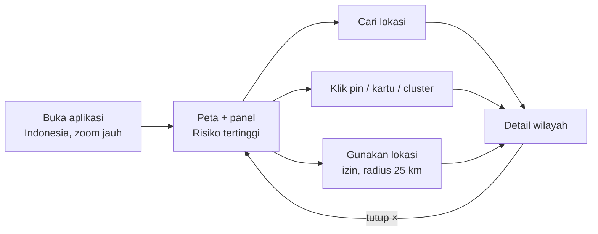
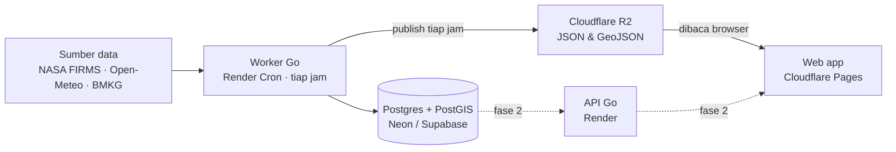

# PRD – Aplikasi Indikator Bencana Alam (Fokus Karhutla)

Versi: 9 Oktober 2026 · Penulis: Braiyen

## Ringkasan

Aplikasi web untuk Indonesia yang menampilkan titik panas kebakaran hutan dan lahan (karhutla) secara hampir real-time di peta, lengkap dengan skor risiko per kabupaten/kota dan kondisi cuaca serta kualitas udara di sekitarnya. MVP hanya versi web (desktop dan responsif), seluruh teks berbahasa Indonesia, dan berfokus pada karhutla.

**Latar belakang.** Data titik panas dan cuaca sebenarnya tersedia gratis (NASA FIRMS, BMKG, Open-Meteo), tetapi tersebar di banyak portal, formatnya berbeda, dan belum diolah menjadi indikator yang mudah dipahami orang awam. Aplikasi ini menyatukannya dalam satu peta dan satu skor risiko yang bisa langsung ditindaklanjuti.

**Desain.** Pola tampilan mengikuti Google Maps: peta layar penuh dengan satu panel mengambang di kiri. Mockup interaktif dan spesifikasi UI ada di [kanvas desain](https://claude.ai/artifact/Utfs6e6arzmSq2oZ6o9fwM).

## Tujuan dan metrik

**Tujuan**

- Menampilkan titik panas baru di peta paling lambat 60 menit setelah data NASA FIRMS tersedia.
- Memberi satu skor risiko per kabupaten/kota dalam 3 kategori: Rendah, Sedang, Sangat tinggi.
- Menunjukkan risiko di sekitar pengguna (radius 25 km) bila pengguna mengizinkan akses lokasi.

**Bukan tujuan (MVP)**

- Aplikasi mobile native atau tampilan khusus mobile.
- Notifikasi (email/Telegram) dan akun pengguna.
- Unduh data, filter rentang waktu, dan dark mode.
- Prediksi kebakaran beberapa hari ke depan, atau menggantikan data resmi BNPB/Kementerian Kehutanan.

**Metrik keberhasilan**

| Metrik | Target |
| --- | --- |
| Keterlambatan data (tersedia di FIRMS → tampil di peta) | ≤ 60 menit |
| Keberhasilan job worker per hari | ≥ 99% |
| Waktu muat halaman pertama | ≤ 3 detik |
| Pengguna aktif mingguan setelah 3 bulan | 500 |

## Pengguna dan user stories

| Pengguna | Kebutuhan utama |
| --- | --- |
| Warga di daerah rawan karhutla | Tahu apakah ada titik panas di dekat tempat tinggalnya dan seberapa berbahaya |
| Relawan / BPBD daerah | Melihat wilayah dengan risiko tertinggi di provinsinya untuk menentukan prioritas |
| Jurnalis / peneliti | Melihat kondisi terkini dan tren 7 hari per kabupaten/kota |

**User stories**

1. Sebagai warga, saya ingin menekan "Gunakan lokasi" dan langsung melihat risiko serta jumlah titik panas dalam radius 25 km.
2. Sebagai warga, saya ingin mencari nama kabupaten/kota dan langsung diarahkan ke wilayah itu di peta.
3. Sebagai relawan, saya ingin memfilter per provinsi dan melihat daftar wilayah dengan skor tertinggi.
4. Sebagai siapa pun, saya ingin mengklik wilayah dan membaca ringkasan risiko, cuaca, kualitas udara, serta tren titik panas 7 hari.

## Fitur MVP

| Fitur | Deskripsi | Prioritas |
| --- | --- | --- |
| Peta Indonesia | Peta layar penuh (mapcn/MapLibre): zoom dengan scroll/pinch, geser, double-click | P0 |
| Pin skor & cluster | Pin berisi skor risiko berwarna kategori; titik berdekatan digabung saat zoom jauh; halo lembut berdenyut untuk Sangat tinggi dan Sedang | P0 |
| Pencarian lokasi | Cari kabupaten/kota, toleran salah ketik, peta langsung zoom ke hasil | P0 |
| Filter | Dropdown provinsi custom (bukan select bawaan) + chip kategori dengan jumlah wilayah. Awalnya tidak ada chip terpilih (semua tampil); klik chip = tampilkan hanya kategori itu, bisa pilih lebih dari satu; chip terpilih berlatar gelap | P0 |
| Panel ringkasan | Total titik panas 24 jam + tren 7 hari, daftar wilayah risiko tertinggi | P0 |
| Detail wilayah | Kartu risiko (kategori + skor/100 + skala Rendah–Sedang–Sangat tinggi, penjelasan di ikon ⓘ), ringkasan, "Yang bisa kamu lakukan" (saran per kategori dan kualitas udara, termasuk Damkar 113/112), kondisi saat ini (titik panas, cuaca, kelembapan, angin, hari tanpa hujan, PM2.5), tren 7 hari, info teknis satelit (terlipat) | P0 |
| Lokasi pengguna | Kartu pra-izin (Lanjutkan / Nanti saja) → prompt browser → titik lokasi + radius 25 km, risiko dan titik panas terdekat; pesan arahan bila ditolak | P1 |
| Status data | Waktu pembaruan terakhir dan penanda bila sumber data bermasalah | P1 |

P0 wajib ada saat rilis pertama, P1 ditargetkan masuk rilis yang sama bila waktu cukup.

## Alur pengguna



Peta dan panel ringkasan adalah titik masuk utama; pengguna sampai ke detail wilayah lewat pencarian, klik pin/kartu, atau lokasinya sendiri, lalu kembali ke ringkasan dengan tombol ×.

## Sumber data

Semua sumber MVP gratis untuk penggunaan non-komersial; atribusi ditampilkan di panel sebagai "Data: NASA FIRMS · BMKG · Open-Meteo".

| Sumber | Data | Frekuensi | Akses |
| --- | --- | --- | --- |
| NASA FIRMS (VIIRS SNPP, NOAA-20, MODIS) | Titik panas: koordinat, tingkat keyakinan, intensitas api (FRP), waktu deteksi | Tiap 1 jam | API CSV per negara (IDN), butuh MAP\_KEY gratis |
| Open-Meteo Weather | Suhu, kelembapan, angin, curah hujan per kabupaten/kota | Tiap 1 jam | API JSON, banyak koordinat per request |
| Open-Meteo Air Quality | PM2.5 per kabupaten/kota | Tiap 1 jam | API JSON |
| BMKG | Cuaca resmi sebagai pembanding/cadangan | Opsional | API JSON |
| Batas administrasi (BIG / GADM) | Poligon provinsi dan kabupaten/kota | Sekali, statis | GeoJSON, disederhanakan |
| SiPongi+ (Kemenhut) | Titik panas versi pemerintah untuk validasi | Opsional | Belum ada API resmi |

**Pertanyaan terbuka:** bila aplikasi dikomersialkan, Open-Meteo dan basemap perlu paket berbayar atau diganti.

## Logika skor risiko

Skor 0–100 dihitung per kabupaten/kota setiap jam oleh worker dari tiga komponen yang masing-masing dinormalisasi ke 0–100. Bobot di bawah adalah titik awal dan akan dikalibrasi dengan data karhutla 2019 dan 2023.

```latex
Skor = 0{,}5 \cdot T + 0{,}3 \cdot C + 0{,}2 \cdot F
```

- **T (titik panas):** jumlah titik panas tingkat keyakinan sedang/tinggi dalam 24 jam, ditambah total intensitas api (FRP).
- **C (cuaca):** makin rendah kelembapan, makin kencang angin, dan makin lama tidak hujan, makin tinggi nilainya.
- **F (tren):** kenaikan jumlah titik panas dibanding rata-rata 7 hari sebelumnya.

| Kategori | Rentang skor | Tampilan |
| --- | --- | --- |
| Rendah | 0–33 | Hijau |
| Sedang | 34–66 | Kuning + halo berdenyut lebih pelan (3,4 detik) |
| Sangat tinggi | 67–100 | Merah + halo berdenyut (2,6 detik) |

Titik panas dengan tingkat keyakinan rendah tetap tampil di peta tetapi tidak dihitung dalam skor, karena bisa berasal dari flare gas atau pembakaran industri. Batas rentang skor masih usulan.

## Arsitektur dan kebutuhan non-fungsional



Worker Go mengambil data, menyimpan dan menghitung skor di Postgres, lalu menerbitkan tiga file statis ke R2; frontend hanya membaca file itu sehingga MVP tidak butuh server API. API Go (garis putus-putus) baru dibangun di fase 2 dengan bentuk data yang sama.

**Kebutuhan non-fungsional**

- **Ketersediaan:** web ≥ 99% per bulan; bila worker gagal, `meta.json` menandai status data dan panel menampilkannya.
- **Performa:** halaman pertama ≤ 3 detik; file JSON dikompresi dan di-cache CDN maksimal 5 menit.
- **Keamanan:** `FIRMS_MAP_KEY`, `DATABASE_URL`, dan kunci R2 disimpan di environment variable Render, tidak di kode; bucket R2 hanya-baca untuk publik.
- **Retensi data:** titik panas disimpan minimal 2 tahun di Postgres untuk kalibrasi skor dan analisis tren.
- **Kepatuhan:** atribusi sumber data tampil di panel.
- **Tampilan:** web saja, light mode, bahasa Indonesia, menghormati `prefers-reduced-motion`.

## Tech stack dan infrastruktur

MVP tidak memakai layanan AWS: penyimpanan di Cloudflare R2, database di Neon atau Supabase, worker dan API di Render, frontend di Cloudflare Pages.

| Lapisan | Pilihan | Catatan |
| --- | --- | --- |
| Frontend | Vite, React + TypeScript, Tailwind CSS, shadcn/ui, lucide-react | SPA statis tanpa Next.js; detail token di Spesifikasi UI |
| Peta | mapcn + MapLibre GL JS, basemap OpenFreeMap/CARTO | Cluster, `flyTo`, geolokasi bawaan MapLibre |
| Data di frontend | TanStack Query, Zustand, Fuse.js, @turf/distance | Refresh 15 menit, pencarian toleran salah ketik, radius 25 km |
| Worker | Go 1.22+, pgx v5, sqlc, goose, go-retryablehttp, paulmach/orb, log/slog | Dijalankan sebagai Render Cron Job tiap jam |
| API (fase 2) | Go `net/http` (opsional chi) | Render Web Service; endpoint `/v1/wilayah`, `/v1/titik-panas`, `/v1/sekitar` |
| Database | PostgreSQL + PostGIS di Neon atau Supabase | Join spasial, radius, deduplikasi titik panas |
| Penyimpanan | Cloudflare R2 | `wilayah.json`, `titik-panas-24j.geojson`, `meta.json`; diakses lewat klien S3 di Go |
| Hosting web | Cloudflare Pages | CDN gratis, satu ekosistem dengan R2 |
| Kualitas | ESLint + Prettier, Vitest, golangci-lint, testcontainers-go | Uji logika skor dan query PostGIS |

**Keputusan terbuka: Neon atau Supabase.** Usulan: **Neon** untuk MVP karena murni Postgres + PostGIS dan cukup untuk worker yang menulis tiap jam; pilih **Supabase** bila fase berikutnya butuh login dan notifikasi bawaan. Batas paket gratis Neon, Supabase, Render, dan R2 perlu dicek ulang sebelum rilis.

## Risiko, asumsi, dan timeline

**Risiko**

| Risiko | Dampak | Mitigasi |
| --- | --- | --- |
| API FIRMS/Open-Meteo lambat atau gagal | Data tidak diperbarui | Retry otomatis; `meta.json` menandai status, panel menampilkan waktu pembaruan terakhir |
| Titik panas palsu (flare gas, industri) | Kepanikan warga | Abaikan tingkat keyakinan rendah dalam skor; ikon ⓘ "belum tentu kebakaran" |
| Skor risiko tidak akurat | Kepercayaan turun | Kalibrasi bobot dengan data karhutla 2019 dan 2023 |
| Batas paket gratis Neon/Supabase/Render terlampaui | Layanan berhenti | Pantau pemakaian; worker hanya menulis tiap jam; siapkan anggaran paket berbayar terkecil |
| Perubahan lisensi sumber data atau basemap | Harus ganti sumber | Klien tiap sumber dipisah di `internal/` sehingga mudah diganti |

**Asumsi:** dikerjakan 1–2 orang paruh waktu; MVP memakai paket gratis/termurah; data cukup diperbarui tiap jam.

**Timeline (8 minggu)**

1. Minggu 1–2: skema Postgres + PostGIS, batas wilayah, worker Go mengambil NASA FIRMS dan deduplikasi.
2. Minggu 3: cuaca dan PM2.5 dari Open-Meteo, perhitungan skor dan tren 7 hari.
3. Minggu 4: publish `wilayah.json`, `titik-panas-24j.geojson`, `meta.json` ke R2; jadwal Render Cron Job.
4. Minggu 5–6: frontend Vite + React: peta mapcn, pin, cluster, panel ringkasan, detail wilayah, pencarian, filter provinsi.
5. Minggu 7: lokasi pengguna (radius 25 km), status data, poles sesuai Spesifikasi UI.
6. Minggu 8: uji coba dengan 10–20 pengguna, perbaikan, rilis MVP di Cloudflare Pages.
